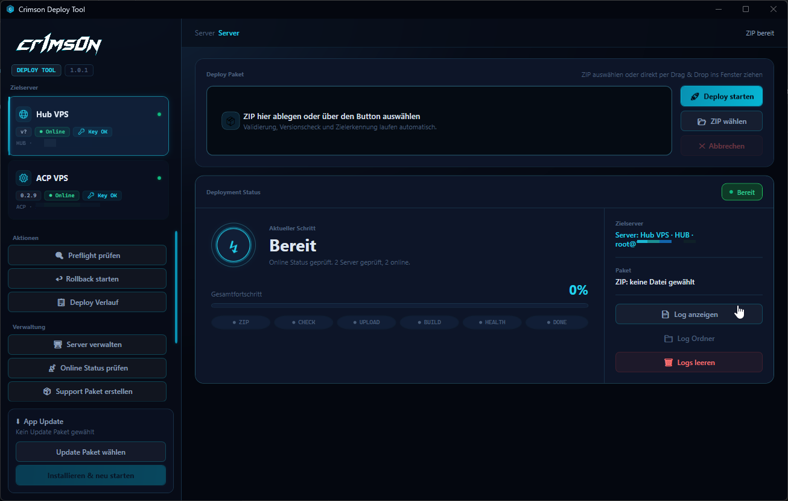

# Crimson Deployment Tools

Windows-Werkzeug für SSH-basierte Deployments der Hub- und ACP-Anwendungen. Die Oberfläche nutzt **PowerShell/WPF**; Launcher und lokaler App-Updater sind in **Go** geschrieben.



## Funktionen

- Serverprofile, Verbindungsprüfung und Deployment-Preflight.
- ZIP-Pakete mit Versionsprüfung, Upload per SCP und Ausführung per SSH.
- Deployment-Verlauf, Livefeed und Rollback-Auswahl.
- Lokale Konfigurationssicherungen und Update-Pakete für das Tool selbst.

## Starten

Benötigt werden Windows, Windows PowerShell mit WPF sowie OpenSSH-Client (`ssh.exe`, `scp.exe`).

```powershell
.\Start-Debug.cmd
```

Server im Dialog anlegen oder `config/servers.example.json` als Vorlage für `config/servers.json` verwenden. Die Vorlage enthält ausschließlich Beispieladressen. Private SSH-Schlüssel bleiben außerhalb des Repositorys.

App-Einstellungen entstehen beim ersten Start lokal; `config/app-settings.example.json` dokumentiert die Standardwerte.

## Programmpaket

```powershell
.\package.ps1
```

Das Paket unter `dist/Deployment` enthält nur den Starter `Crimson Deploy Tool.exe` und `app/`. Dort liegen Ressourcen, Updater sowie die lokal erzeugten Konfigurationen, Logs und Laufzeitdateien. Relative SSH-Schlüsselpfade beziehen sich weiterhin auf den Hauptordner. Für Updates die App schließen und das vollständige Paket verwenden; persönliche Konfigurationen erhalten.

Bei der Umstellung bestehender Installationen bleiben bereits vorhandene Backups an ihrem bisherigen Ort. Ein vorhandener Quell-Arbeitsstand kann separat unter `source/` liegen; beide Ordner lassen sich im Explorer ausblenden.

## Bauen

Mit **Go ab 1.23**:

```powershell
.\build.ps1
```

Erzeugt `Crimson Deploy Tool.exe`, den kompatiblen Launcher-Namen `Crimson Native Deployer.exe` und `Crimson Updater.exe` für Windows x64. Die EXEs sind Build-Ausgaben und werden nicht versioniert. Die `.syso`-Dateien enthalten die benötigten Windows-Iconressourcen.

Update-Paket erstellen:

```powershell
.\tools\Create-UpdatePackage.ps1 -Version 1.0.2
```

Details: [Update-Pakete](UPDATE_PACKAGES.md) · [Änderungen](CHANGELOG.md) · [manuelle Abnahme](TESTPLAN.md).

Prüfungen ohne produktive SSH-Aktionen:

```powershell
.\tests\Behavior.Tests.ps1
.\tests\Layout.Tests.ps1
.\tests\Redaction.Tests.ps1
Set-Location src-updater
go test ./...
```

Die WPF-Layoutprüfung benötigt Windows PowerShell mit `-STA`. Sie lädt das echte XAML und prüft die Pill-Geometrie ohne Serververbindungen.

## Daten und Grenzen

Persönliche Serverprofile, Deployment-Zustand, Logs, Laufzeitdateien und Sicherungen werden lokal gespeichert und nicht eingecheckt. Update-Pakete enthalten nur ausdrücklich freigegebene Dateien.

Deployments sind auf die vorhandenen Hub-/ACP-Verzeichnisse und Dienste zugeschnitten; das Tool ist kein allgemeiner Deployer. Die bestehenden Abläufe können Sicherungen anlegen, ältere Sicherungen entfernen und Dienste neu starten. Vor produktiven Aktionen Ziel und erzeugtes Skript prüfen. Die Paketprüfung ersetzt keine kryptografische Signaturprüfung.
